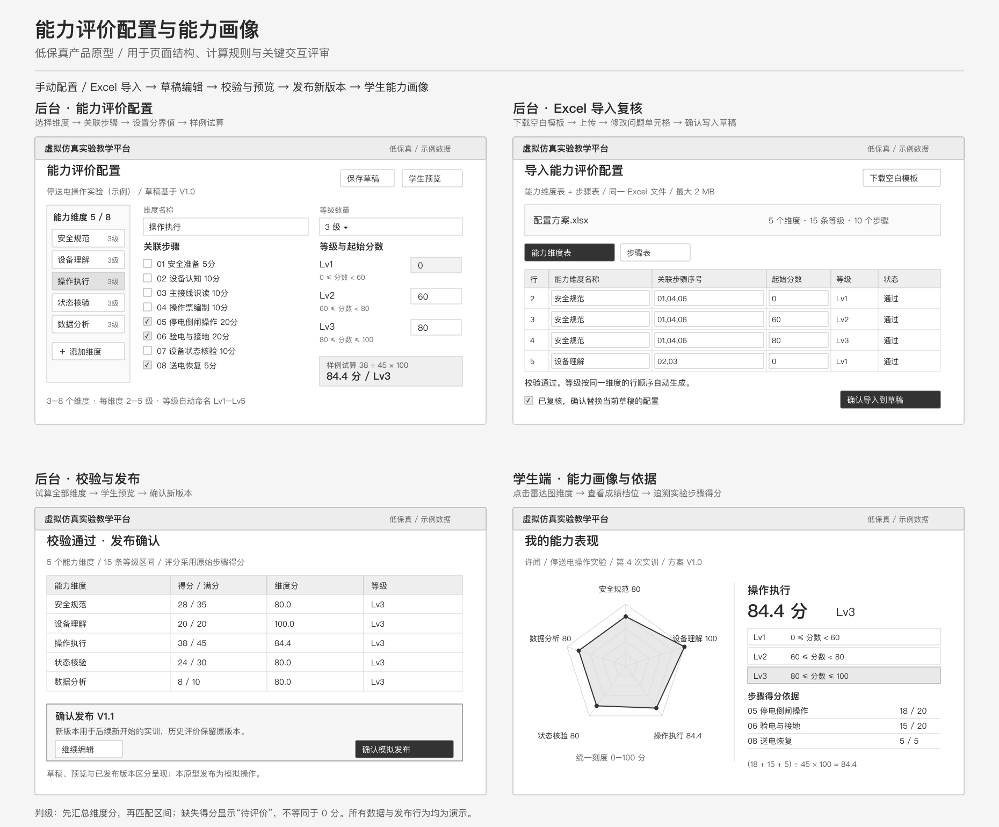

# 能力维度雷达图配置原型

虚拟仿真实验能力评价的交互演示，包括后台配置、Excel 导入复核、学生端雷达图及计算流程。

## 在线低保真原型

- [打开交互原型](https://capability-radar-config.blithe-oasis-1095.chatgpt.site/prototype/)
- [查看四屏总览](prototype/overview.png)
- [下载 Excel 空白模板](prototype/能力评价配置空白模板.xlsx)
- [页面与规则说明](prototype/README.md)

新增灰度线框页面覆盖后台配置、Excel 导入复核、校验发布、学生画像与步骤依据。保存和发布为会话内演示，未连接真实教学服务。



## 运行

直接用浏览器打开 `index.html`，或在此目录运行：

```sh
python3 -m http.server 8000
```

然后访问 `http://localhost:8000/`。无需安装依赖或执行构建。

## 文件说明

- `index.html`：用户提供的 `capability-radar-config.html` 原样保存，仅更改文件名作为静态入口。
- 页面中的 sandboxed iframe 与 Content Security Policy 均完整保留。
- 本项目是产品交互原型，使用示例数据，未连接真实教学后台或 AI 服务。

## 版本校验

`index.html` SHA-256：

```
10360e6bc8dd9160427f8d51ae4fa03420184963df1f3a1d8e6104a149bbde11
```
